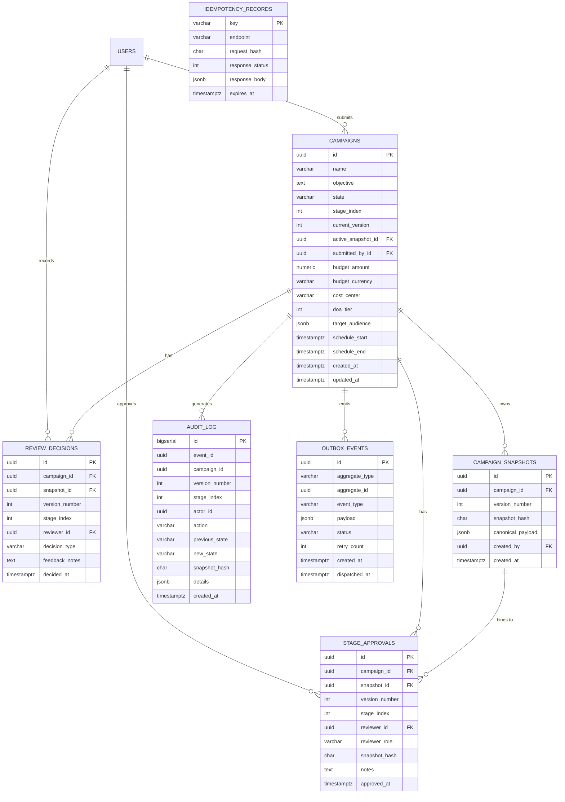

# Relational Database Schema Specification

> **Document Status:** Approved v1.0  
> **Last Updated:** 2026-11-01  
> **Owner:** Domain Research & Requirements Lead  
> **Traces to:** [`domain-model.md`](domain-model.md), [`functional-requirements.md`](../01-problem-understanding/functional-requirements.md), [`non-functional-requirements.md`](../01-problem-understanding/non-functional-requirements.md), [`approval-workflow.md`](../04-workflows/approval-workflow.md)

---

## 1. Overview & Storage Architecture

The **Campaign Review & Approval Platform** utilizes **PostgreSQL 15+** as its primary system of record. PostgreSQL provides strong ACID guarantees, row-level concurrency control, robust JSONB querying for immutable payload snapshots, and reliable transaction boundaries required for the **Transactional Outbox Pattern** (`NFR-005`).

### 1.1 Core Relational Schema Overview



---

## 2. Table DDL Specifications

### 2.1 Table: `users`
Stores user accounts, system privileges, and specialized review role assignments.

```sql
CREATE TABLE users (
    id UUID PRIMARY KEY DEFAULT gen_random_uuid(),
    email VARCHAR(255) NOT NULL UNIQUE,
    full_name VARCHAR(150) NOT NULL,
    role VARCHAR(50) NOT NULL,
    is_active BOOLEAN NOT NULL DEFAULT TRUE,
    created_at TIMESTAMPTZ NOT NULL DEFAULT CURRENT_TIMESTAMP,
    updated_at TIMESTAMPTZ NOT NULL DEFAULT CURRENT_TIMESTAMP,

    CONSTRAINT chk_user_role CHECK (
        role IN ('Marketer', 'CreativeReviewer', 'ComplianceReviewer', 'FinanceApprover', 'Administrator')
    )
);
```

---

### 2.2 Table: `campaigns`
The primary aggregate root table representing mutable campaign working state and active lifecycle stage.

```sql
CREATE TABLE campaigns (
    id UUID PRIMARY KEY DEFAULT gen_random_uuid(),
    name VARCHAR(255) NOT NULL,
    objective TEXT NOT NULL,
    state VARCHAR(50) NOT NULL DEFAULT 'DRAFT',
    stage_index INT NOT NULL DEFAULT 1,
    current_version INT NOT NULL DEFAULT 1,
    active_snapshot_id UUID,
    submitted_by_id UUID NOT NULL REFERENCES users(id),
    
    -- Budget Value Object
    budget_amount NUMERIC(14, 2) NOT NULL,
    budget_currency VARCHAR(3) NOT NULL DEFAULT 'USD',
    cost_center VARCHAR(100) NOT NULL,
    doa_tier INT NOT NULL DEFAULT 1,

    -- Audience & Scheduling Value Objects
    target_audience JSONB NOT NULL,
    schedule_start TIMESTAMPTZ NOT NULL,
    schedule_end TIMESTAMPTZ NOT NULL,

    -- Concurrency & Timestamps
    created_at TIMESTAMPTZ NOT NULL DEFAULT CURRENT_TIMESTAMP,
    updated_at TIMESTAMPTZ NOT NULL DEFAULT CURRENT_TIMESTAMP,

    -- Constraints
    CONSTRAINT chk_campaign_state CHECK (
        state IN ('DRAFT', 'PENDING_REVIEW', 'CHANGES_REQUESTED', 'APPROVED', 'REJECTED', 'SCHEDULED')
    ),
    CONSTRAINT chk_stage_index CHECK (stage_index BETWEEN 1 AND 3),
    CONSTRAINT chk_budget_positive CHECK (budget_amount > 0),
    CONSTRAINT chk_dates_valid CHECK (schedule_end > schedule_start),
    CONSTRAINT chk_doa_tier CHECK (doa_tier BETWEEN 1 AND 3)
);
```

---

### 2.3 Table: `campaign_snapshots`
Immutable point-in-time state captures of campaign proposals frozen upon submission.

```sql
CREATE TABLE campaign_snapshots (
    id UUID PRIMARY KEY DEFAULT gen_random_uuid(),
    campaign_id UUID NOT NULL REFERENCES campaigns(id) ON DELETE RESTRICT,
    version_number INT NOT NULL,
    snapshot_hash CHAR(64) NOT NULL, -- SHA-256 Digest of canonical_payload
    canonical_payload JSONB NOT NULL,
    created_by UUID NOT NULL REFERENCES users(id),
    created_at TIMESTAMPTZ NOT NULL DEFAULT CURRENT_TIMESTAMP,

    CONSTRAINT uq_campaign_snapshot_version UNIQUE (campaign_id, version_number)
);

-- Foreign Key from campaigns to active snapshot
ALTER TABLE campaigns 
    ADD CONSTRAINT fk_active_snapshot 
    FOREIGN KEY (active_snapshot_id) REFERENCES campaign_snapshots(id) 
    DEFERRABLE INITIALLY DEFERRED;
```

---

### 2.4 Table: `stage_approvals`
Authoritative multi-stage approval ledger tracking explicit sign-offs per stage.

```sql
CREATE TABLE stage_approvals (
    id UUID PRIMARY KEY DEFAULT gen_random_uuid(),
    campaign_id UUID NOT NULL REFERENCES campaigns(id) ON DELETE RESTRICT,
    snapshot_id UUID NOT NULL REFERENCES campaign_snapshots(id) ON DELETE RESTRICT,
    version_number INT NOT NULL,
    stage_index INT NOT NULL,
    reviewer_id UUID NOT NULL REFERENCES users(id),
    reviewer_role VARCHAR(50) NOT NULL,
    snapshot_hash CHAR(64) NOT NULL,
    notes TEXT,
    approved_at TIMESTAMPTZ NOT NULL DEFAULT CURRENT_TIMESTAMP,

    CONSTRAINT chk_approval_stage CHECK (stage_index IN (1, 2, 3)),
    -- Invariant: Exactly one approval per stage per snapshot
    CONSTRAINT uq_stage_approval_per_snapshot UNIQUE (campaign_id, snapshot_id, stage_index)
);
```

---

### 2.5 Table: `review_decisions`
Chronological history of all review actions (Stage Approvals, Requests for Changes, Rejections).

```sql
CREATE TABLE review_decisions (
    id UUID PRIMARY KEY DEFAULT gen_random_uuid(),
    campaign_id UUID NOT NULL REFERENCES campaigns(id) ON DELETE RESTRICT,
    snapshot_id UUID NOT NULL REFERENCES campaign_snapshots(id) ON DELETE RESTRICT,
    version_number INT NOT NULL,
    stage_index INT NOT NULL,
    reviewer_id UUID NOT NULL REFERENCES users(id),
    decision_type VARCHAR(50) NOT NULL,
    feedback_notes TEXT,
    decided_at TIMESTAMPTZ NOT NULL DEFAULT CURRENT_TIMESTAMP,

    CONSTRAINT chk_decision_type CHECK (
        decision_type IN ('STAGE_APPROVED', 'CHANGES_REQUESTED', 'REJECTED')
    ),
    CONSTRAINT chk_feedback_required CHECK (
        (decision_type IN ('CHANGES_REQUESTED', 'REJECTED') AND feedback_notes IS NOT NULL AND length(trim(feedback_notes)) >= 10)
        OR decision_type = 'STAGE_APPROVED'
    )
);
```

---

### 2.6 Table: `audit_log`
Append-only immutable audit trail capturing forensic evidence of all lifecycle transitions.

```sql
CREATE TABLE audit_log (
    id BIGSERIAL,
    event_id UUID NOT NULL DEFAULT gen_random_uuid(),
    campaign_id UUID NOT NULL,
    version_number INT NOT NULL,
    stage_index INT,
    actor_id UUID NOT NULL,
    action VARCHAR(100) NOT NULL,
    previous_state VARCHAR(50),
    new_state VARCHAR(50),
    snapshot_hash CHAR(64),
    details JSONB,
    client_ip VARCHAR(45),
    user_agent VARCHAR(255),
    created_at TIMESTAMPTZ NOT NULL DEFAULT CURRENT_TIMESTAMP,

    PRIMARY KEY (id, created_at)
) PARTITION BY RANGE (created_at);
```

---

### 2.7 Table: `outbox_events`
Transactional Outbox queue ensuring at-least-once asynchronous event delivery.

```sql
CREATE TABLE outbox_events (
    id UUID PRIMARY KEY DEFAULT gen_random_uuid(),
    aggregate_type VARCHAR(100) NOT NULL DEFAULT 'Campaign',
    aggregate_id UUID NOT NULL,
    event_type VARCHAR(100) NOT NULL,
    payload JSONB NOT NULL,
    status VARCHAR(50) NOT NULL DEFAULT 'PENDING',
    retry_count INT NOT NULL DEFAULT 0,
    last_error TEXT,
    created_at TIMESTAMPTZ NOT NULL DEFAULT CURRENT_TIMESTAMP,
    dispatched_at TIMESTAMPTZ,

    CONSTRAINT chk_outbox_status CHECK (status IN ('PENDING', 'SENT', 'FAILED'))
);
```

---

### 2.8 Table: `idempotency_records`
Client-generated request deduplication table supporting mobile network retries.

```sql
CREATE TABLE idempotency_records (
    key VARCHAR(128) PRIMARY KEY,
    endpoint VARCHAR(255) NOT NULL,
    request_hash CHAR(64) NOT NULL,
    response_status INT NOT NULL,
    response_body JSONB NOT NULL,
    created_at TIMESTAMPTZ NOT NULL DEFAULT CURRENT_TIMESTAMP,
    expires_at TIMESTAMPTZ NOT NULL
);
```

---

## 3. Database Indexes for High-Performance Queries

To guarantee sub-50ms response times on mobile devices (`NFR-014`):

```sql
-- 1. Reviewer Queue Lookups (Fast filtering by state & stage)
CREATE INDEX idx_campaigns_review_queue 
    ON campaigns (state, stage_index, updated_at DESC) 
    WHERE state = 'PENDING_REVIEW';

-- 2. Marketer Campaign Dashboard (Filter by creator & status)
CREATE INDEX idx_campaigns_marketer 
    ON campaigns (submitted_by_id, state, updated_at DESC);

-- 3. Active Snapshot Resolution
CREATE INDEX idx_snapshots_campaign_ver 
    ON campaign_snapshots (campaign_id, version_number DESC);

-- 4. Stage Approvals Verification (Scheduling Gate Fast-Path)
CREATE INDEX idx_stage_approvals_snapshot 
    ON stage_approvals (snapshot_id, stage_index);

-- 5. Outbox Dispatch Worker (Polling pending events)
CREATE INDEX idx_outbox_pending 
    ON outbox_events (status, created_at ASC) 
    WHERE status = 'PENDING';

-- 6. Idempotency Key Expiration Cleanup
CREATE INDEX idx_idempotency_expiry 
    ON idempotency_records (expires_at);

-- 7. Audit Log Campaign Timeline
CREATE INDEX idx_audit_campaign_time 
    ON audit_log (campaign_id, created_at DESC);
```

---

## 4. Partitioning & Data Retention Strategy

### 4.1 Audit Log Partitioning
The `audit_log` table is partitioned by date range (Monthly) using PostgreSQL declarative partitioning:
```sql
-- Example Monthly Partitions
CREATE TABLE audit_log_2026_11 PARTITION OF audit_log
    FOR VALUES FROM ('2026-11-01 00:00:00+00') TO ('2026-12-01 00:00:00+00');

CREATE TABLE audit_log_2026_12 PARTITION OF audit_log
    FOR VALUES FROM ('2026-12-01 00:00:00+00') TO ('2027-01-01 00:00:00+00');
```
- **Benefits:** Fast sequential writes, zero lock contention with transactional queries, and instant partition dropping for retention policy compliance without table vacuum overhead.

### 4.2 Idempotency Key TTL Eviction
A lightweight background cron runs every hour to purge expired keys:
```sql
DELETE FROM idempotency_records WHERE expires_at < CURRENT_TIMESTAMP;
```

---

## 5. Migration Strategy & Zero-Downtime Deployment

1. **Expansion-Contract Migration Pattern:**
   - All schema changes must be backward-compatible (new columns nullable or carry safe defaults).
   - Application version $N+1$ reads from both old and new columns, and writes to both.
   - Application version $N+2$ cuts over completely, followed by dropping deprecated columns in an off-peak maintenance window.
2. **Schema Version Tracking:**
   - Managed via Flyway or Liquibase migrations version-controlled in `/migrations/`. Every migration script must be idempotent and transactional.

---

## 6. Defensible Database Architecture Choices

### 6.1 Relational PostgreSQL vs. Document NoSQL (MongoDB)
- **Chosen Approach:** Relational PostgreSQL with JSONB columns.
- **Why Chosen:** Campaign review pipelines require multi-table ACID transaction consistency across `campaigns`, `stage_approvals`, `audit_log`, and `outbox_events`. MongoDB's multi-document transactions incur high latency overhead and lack the strict relational constraints required by SOX 404 financial audits.
- **Why Not Pure Document Store:** High risk of data anomalies, lack of relational foreign key integrity, and weak optimistic locking mechanisms.

### 6.2 Transactional Outbox vs. Dual-Write Architecture
- **Chosen Approach:** In-database `outbox_events` table committed atomically with the campaign state transition.
- **Why Chosen:** Eliminates the dual-write distributed transaction failure mode. If external message brokers (Kafka/RabbitMQ) or push notification gateways (FCM) experience temporary outages, the business transaction is never corrupted or aborted.
- **Why Not Dual-Write:** Dual-write inevitably leads to phantom notifications or lost messages when one of the two writes fails.
