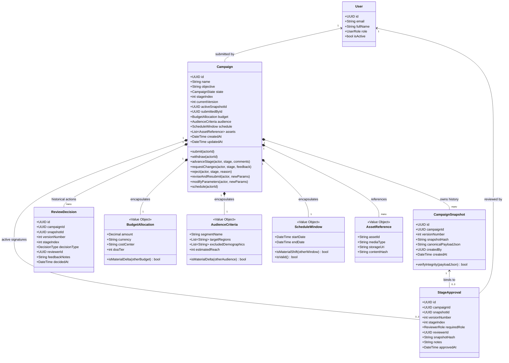
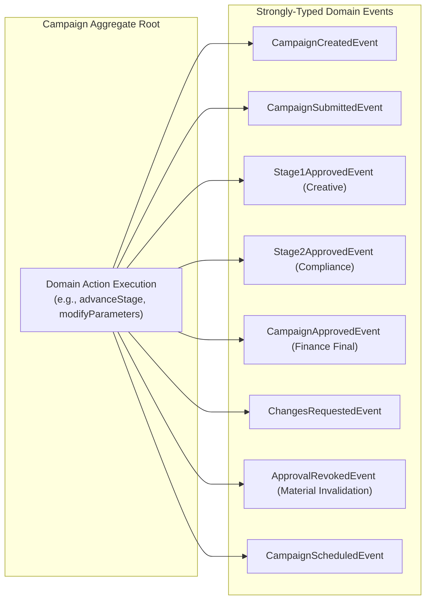

# Domain Model Specification

> **Document Status:** Approved v1.0  
> **Last Updated:** 2026-11-01  
> **Owner:** Domain Research & Requirements Lead  
> **Traces to:** [`problem-statement.md`](../01-problem-understanding/problem-statement.md), [`functional-requirements.md`](../01-problem-understanding/functional-requirements.md), [`non-functional-requirements.md`](../01-problem-understanding/non-functional-requirements.md), [`approval-workflow.md`](../04-workflows/approval-workflow.md), [`campaign-lifecycle.md`](../04-workflows/campaign-lifecycle.md)

---

## 1. Domain Overview & Ubiquitous Language

The **Campaign Review & Approval Platform** is structured using Domain-Driven Design (DDD) principles. The domain model isolates the business rules governing campaign proposals, immutable version snapshots, multi-level sequential approvals, material change invalidation, and scheduling gate clearance.

### 1.1 Ubiquitous Language Glossary

| Term | Definition | Context & Invariants |
|:---|:---|:---|
| **Campaign** | The primary business aggregate root representing a marketing proposal throughout its entire lifecycle. | Encapsulates mutable draft parameters, current lifecycle state, active review stage, and version pointer. |
| **Campaign Snapshot** | An immutable, point-in-time state capture of a campaign generated upon submission. | Holds a canonical JSON representation and a SHA-256 cryptographic digest (`snapshot_hash`). Read-only once written. |
| **Review Stage** | A discrete, sequential evaluation gate within the review pipeline: `Stage 1: Creative`, `Stage 2: Compliance`, `Stage 3: Finance`. | Monotonically advancing ($1 \rightarrow 2 \rightarrow 3$). Governed by specialized role permissions. |
| **Stage Approval** | An authoritative sign-off granted by a qualified domain reviewer for a specific stage on an immutable snapshot. | Bound to `(snapshot_hash, stage_index, version_number)`. |
| **Material Change** | A mutation to high-risk campaign parameters (budget $\ge \pm 10\%$, audience pivot, claims/disclaimers, dates $> 72$h) that invalidates existing stage approvals. | Automatically revokes approval tokens, bumps version ($vN \rightarrow vN+1$), and resets pipeline to Stage 1. |
| **Non-Material Change** | A minor metadata edit (e.g., internal campaign tags, UTM telemetry, administrative notes) that does not alter messaging or legal liability. | Preserves existing approval status; logged in the audit trail. |
| **Scheduling Gate** | The final governance barrier between the review platform and outbound delivery execution engines. | Enforces that only campaigns in `APPROVED` state with 3 valid stage approvals matching the current snapshot digest can transition to `SCHEDULED`. |
| **Separation of Duties (SoD)**| Governance invariant prohibiting campaign authors from reviewing or approving their own submissions. | Evaluated as `campaign.submitted_by_id != reviewer.id` across all review stages. |

---

## 2. Domain Class & Entity-Relationship Model



---

## 3. Aggregate Root: `Campaign`

`Campaign` is the **Aggregate Root**. External operations must never mutate internal child entities (`StageApproval`, `CampaignSnapshot`, `ReviewDecision`) directly. All mutations and invariants pass through `Campaign` aggregate root methods.

### 3.1 Aggregate Boundaries
- **Root Entity:** `Campaign`
- **Internal Entities:**
  - `active_snapshot`: Reference to the currently active immutable snapshot (`CampaignSnapshot`).
  - `stage_approvals`: In-memory and persistent collection of active stage approvals clearing the current version.
- **Value Objects:**
  - `BudgetAllocation`
  - `AudienceCriteria`
  - `ScheduleWindow`
  - `AssetReference`
  - `VersionToken` (monotonic version number + SHA-256 digest)

---

## 4. Aggregate Invariants & Business Rules

The `Campaign` aggregate root guarantees the following non-negotiable invariants:

### Invariant 1: Separation of Duties (Anti-Self-Approval)
- **Rule:** The user who created or submitted a campaign proposal can **never** execute an approval, stage advance, change request, or rejection on that campaign (`FR-018`, `NFR-010`).
- **Enforcement:**
  ```python
  if actor.id == self.submitted_by_id:
      raise SeparationOfDutiesViolationException(
          "Actor cannot review their own campaign submission."
      )
  ```

### Invariant 2: Monotonic Sequential Stage Progression
- **Rule:** The review pipeline must strictly advance through the defined sequential stages (`FR-006`, `FR-007`):
  $$\text{Stage 1 (Creative)} \longrightarrow \text{Stage 2 (Compliance)} \longrightarrow \text{Stage 3 (Finance)} \longrightarrow \text{Approved}$$
- Stage $k+1$ evaluation is prohibited unless Stage $k$ holds an existing valid `StageApproval` matching the active `snapshot_hash`.
- Bypassing or jumping stages is structurally impossible.

### Invariant 3: Cryptographic Snapshot Binding
- **Rule:** Review decisions and stage approvals are mathematically bound to an **immutable snapshot digest** (`SHA-256(canonical_payload)`).
- If the campaign payload is mutated after submission, the digest diverges, immediately invalidating the signature (`NFR-002`).

### Invariant 4: Material Change Invalidation & Pipeline Reset
- **Rule:** When `modifyParameters()` is called on a campaign in `APPROVED` or `PENDING_REVIEW` state, the aggregate evaluates parameter materiality (`FR-014`):
  - **Budget:** Delta $\ge \pm 10\%$ or crossing DOA authorization limits.
  - **Audience:** Demographic/geo expansion or estimated reach shift $> 15\%$.
  - **Creative Copy / Assets:** Any headline, body text, link, or legal disclaimer update.
  - **Schedule:** Launch date shift $> 72$ hours.
- **Action:** If any material delta is detected:
  1. Revokes all active `StageApproval` entities.
  2. Increments `current_version` ($vN \rightarrow vN+1$).
  3. Transitions state to `CHANGES_REQUESTED` (locking the scheduling gate).
  4. Resets `stage_index = 1`.
  5. Emits `ApprovalRevokedEvent`.

### Invariant 5: Scheduling Gate Verification
- **Rule:** The `schedule()` method can execute **if and only if** (`FR-012`):
  1. `campaign.state == CampaignState.APPROVED`
  2. All three stage approvals (`stage_index IN (1, 2, 3)`) exist.
  3. Every stage approval's `snapshot_hash` equals the active snapshot's `snapshot_hash`.
  4. Zero uncommitted material modifications exist.

---

## 5. Value Objects

Value Objects in the domain are immutable structures defined purely by their attributes:

### 5.1 `BudgetAllocation`
```python
@dataclass(frozen=True)
class BudgetAllocation:
    amount: Decimal
    currency: str
    cost_center: str
    doa_tier: int  # 1: <= $10k (Manager), 2: <= $50k (Director), 3: > $50k (VP/C-Level)

    def is_material_delta(self, other: 'BudgetAllocation') -> bool:
        if self.currency != other.currency or self.cost_center != other.cost_center:
            return True
        if self.doa_tier != other.doa_tier:
            return True
        percentage_delta = abs(self.amount - other.amount) / self.amount
        return percentage_delta >= Decimal("0.10")  # 10% threshold
```

### 5.2 `AudienceCriteria`
```python
@dataclass(frozen=True)
class AudienceCriteria:
    segment_name: str
    target_regions: Tuple[str, ...]
    excluded_demographics: Tuple[str, ...]
    estimated_reach: int

    def is_material_delta(self, other: 'AudienceCriteria') -> bool:
        if set(self.target_regions) != set(other.target_regions):
            return True
        if set(self.excluded_demographics) != set(other.excluded_demographics):
            return True
        variance = abs(self.estimated_reach - other.estimated_reach) / max(self.estimated_reach, 1)
        return variance > 0.15  # 15% audience volume variance
```

### 5.3 `ScheduleWindow`
```python
@dataclass(frozen=True)
class ScheduleWindow:
    start_date: datetime
    end_date: datetime

    def is_material_shift(self, other: 'ScheduleWindow') -> bool:
        shift_delta = abs((self.start_date - other.start_date).total_seconds())
        duration_delta = abs((self.end_date - other.end_date).total_seconds())
        return shift_delta > 72 * 3600 or duration_delta > 72 * 3600  # 72 hours
```

---

## 6. Domain Events Emitted by Aggregate Root

All state mutations in the `Campaign` aggregate root generate strongly-typed Domain Events committed via the Transactional Outbox pattern:



---

## 7. Defensible Architectural Decisions in Domain Modeling

### 7.1 Aggregate Root Boundary Choice
- **Decision:** Model `Campaign` as a single aggregate root encompassing its stage approvals and snapshot pointers, rather than modeling `Review` or `Stage` as independent aggregates.
- **Why Chosen:** Campaign state, current version, and stage approvals share a strict consistency boundary. A campaign cannot advance to Stage 2 unless the campaign aggregate verifies Stage 1 completion atomically. Modeling them as separate aggregates would require distributed transactions or eventual consistency across approval stages, risking split-brain states.
- **Rejected Alternative:** Independent `Review` aggregate. Leads to concurrency anomalies where a campaign is scheduled while a concurrent review is in flight.

### 7.2 Full Snapshot Entity vs. Event Delta Store
- **Decision:** Model `CampaignSnapshot` as a full immutable state copy rather than storing incremental delta events.
- **Why Chosen:** Instant $O(1)$ read performance on mobile review queues, guaranteed deterministic SHA-256 digest calculation for legal audit trails, and zero risk of projection drift during mobile rendering.
- **Rejected Alternative:** Pure Event Sourcing with delta replay. High reconstruction latency on mobile devices, schema versioning complexity, and eventual projection lag at the scheduling gate.
