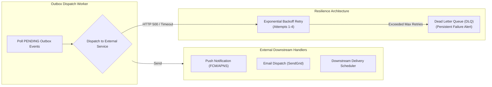

# Domain Event Catalog & Outbox Specification

> **Document Status:** Approved v1.0  
> **Last Updated:** 2026-11-01  
> **Owner:** Domain Research & Requirements Lead  
> **Traces to:** [`domain-model.md`](domain-model.md), [`database-schema.md`](database-schema.md), [`functional-requirements.md`](../01-problem-understanding/functional-requirements.md), [`failure-recovery.md`](../04-workflows/failure-recovery.md)

---

## 1. Event-Driven Architecture Overview

The **Campaign Review & Approval Platform** publishes strongly-typed domain events to decouple the core state machine from asynchronous side-effects (push notifications, email alerts, analytics pipelines, downstream scheduling dispatch).

### 1.1 Outbox & Publishing Guarantees
- **Transactional Outbox:** Every domain event is written to the `outbox_events` table within the same local database transaction that commits the campaign state change (`NFR-005`).
- **At-Least-Once Delivery:** An asynchronous dispatcher worker polls pending events and publishes them to external notification providers (FCM, SendGrid) and downstream execution adapters.
- **Consumer Idempotency:** Every event contains a globally unique `event_id` and a monotonic `version_number`. Downstream consumers must deduplicate using `event_id` to ensure idempotent processing.
- **Partitioning & Ordering Key:** Events are partitioned and ordered by `campaign_id` to guarantee strictly ordered state processing per campaign.

---

## 2. Master Domain Event Catalog

| Event Name | Producer | Primary Consumer(s) | Triggering Condition | Ordering Key | Delivery Guarantee |
|:---|:---|:---|:---|:---|:---|
| **`CampaignCreated`** | Campaign Service | Audit Logger, Analytics Adapter | Marketer initializes a new proposal in `DRAFT` state (`FR-001`). | `campaign_id` | At-least-once |
| **`CampaignSubmitted`** | Campaign Service | Notification Dispatcher (Creative Reviewers), Audit Logger | Marketer submits campaign for review (`FR-004`); generates snapshot `v1`. | `campaign_id` | At-least-once |
| **`Stage1Approved`** | Review Service | Notification Dispatcher (Compliance Officers), Audit Logger | Creative Reviewer (`ST-002a`) signs off on brand/messaging; advances to Stage 2 (`FR-006`). | `campaign_id` | At-least-once |
| **`Stage2Approved`** | Review Service | Notification Dispatcher (Finance Approvers), Audit Logger | Legal/Compliance Officer (`ST-002b`) signs off on regulatory claims; advances to Stage 3 (`FR-006`). | `campaign_id` | At-least-once |
| **`CampaignApproved`** | Review Service | Notification Dispatcher (Marketer & Leadership), Scheduling Engine, Audit Logger | Finance Approver (`ST-002c`) signs off on budget; full clearance granted (`FR-007`). | `campaign_id` | At-least-once |
| **`ChangesRequested`** | Review Service | Notification Dispatcher (Submitting Marketer), Audit Logger | Reviewer at Stage 1, 2, or 3 attaches required revisions (`FR-009`). | `campaign_id` | At-least-once |
| **`CampaignResubmitted`** | Campaign Service | Notification Dispatcher (Stage 1 Reviewers), Audit Logger | Marketer addresses feedback and resubmits proposal; generates snapshot `vN+1` (`FR-010`). | `campaign_id` | At-least-once |
| **`CampaignRejected`** | Review Service | Notification Dispatcher (Submitting Marketer), Audit Logger | Reviewer at any stage rejects proposal with mandatory rationale (`FR-008`). | `campaign_id` | At-least-once |
| **`ApprovalRevoked`** | Campaign Service | Notification Dispatcher (Marketer & Reviewers), Audit Logger | Material parameter change committed on an approved or in-review proposal (`FR-014`). | `campaign_id` | At-least-once |
| **`CampaignScheduled`** | Scheduling Adapter | Execution Dispatcher (Delivery System), Notification Dispatcher, Audit Logger | Scheduling gate verifies all 3 stage approvals and marks campaign as `SCHEDULED` (`FR-012`). | `campaign_id` | At-least-once |
| **`CampaignWithdrawn`** | Campaign Service | Notification Dispatcher (Reviewers), Audit Logger | Marketer withdraws proposal from review prior to initial review action (`FR-005`). | `campaign_id` | At-least-once |

---

## 3. Formal Event Schemas & Payloads

Every event follows the standard CloudEvents specification:

```json
{
  "specversion": "1.0",
  "id": "evt-7f89d421-3a21-4f9e-9f4e-289b41a9bc2e",
  "source": "mal4.martech.campaign-service",
  "time": "2026-11-01T14:30:00.000Z",
  "correlation_id": "req-98f2-411a-82bc",
  "datacontenttype": "application/json"
}
```

---

### 3.1 Event: `CampaignSubmitted`
```json
{
  "specversion": "1.0",
  "id": "evt-01",
  "type": "mal4.campaign.submitted",
  "source": "mal4.martech.campaign-service",
  "time": "2026-11-01T14:30:00Z",
  "data": {
    "campaign_id": "cmp-849204",
    "campaign_name": "Summer Apparel Promo 2026",
    "version_number": 1,
    "snapshot_id": "snp-98214a",
    "snapshot_hash": "e3b0c44298fc1c149afbf4c8996fb92427ae41e4649b934ca495991b7852b855",
    "submitted_by_id": "usr-marketer-01",
    "initial_stage_index": 1,
    "target_audience_segment": "Tier 1 Loyalty",
    "budget_amount": 25000.00,
    "budget_currency": "USD",
    "schedule_start": "2026-12-01T00:00:00Z",
    "schedule_end": "2026-12-15T23:59:59Z"
  }
}
```

---

### 3.2 Event: `Stage1Approved` (Creative Clearance)
```json
{
  "specversion": "1.0",
  "id": "evt-02",
  "type": "mal4.campaign.stage1_approved",
  "source": "mal4.martech.review-service",
  "time": "2026-11-01T14:45:10Z",
  "data": {
    "campaign_id": "cmp-849204",
    "version_number": 1,
    "snapshot_id": "snp-98214a",
    "snapshot_hash": "e3b0c44298fc1c149afbf4c8996fb92427ae41e4649b934ca495991b7852b855",
    "stage_index": 1,
    "stage_name": "Creative & Brand",
    "reviewer_id": "usr-reviewer-creative-01",
    "next_stage_index": 2,
    "next_stage_name": "Legal & Compliance",
    "notes": "Visual branding, tone of voice, and creative copy approved."
  }
}
```

---

### 3.3 Event: `Stage2Approved` (Legal & Compliance Clearance)
```json
{
  "specversion": "1.0",
  "id": "evt-03",
  "type": "mal4.campaign.stage2_approved",
  "source": "mal4.martech.review-service",
  "time": "2026-11-01T15:15:30Z",
  "data": {
    "campaign_id": "cmp-849204",
    "version_number": 1,
    "snapshot_id": "snp-98214a",
    "snapshot_hash": "e3b0c44298fc1c149afbf4c8996fb92427ae41e4649b934ca495991b7852b855",
    "stage_index": 2,
    "stage_name": "Legal & Compliance",
    "reviewer_id": "usr-reviewer-legal-02",
    "next_stage_index": 3,
    "next_stage_name": "Finance & Budget",
    "notes": "GDPR consent verify complete. Promotional disclaimers verified."
  }
}
```

---

### 3.4 Event: `CampaignApproved` (Finance Sign-off / Full Clearance)
```json
{
  "specversion": "1.0",
  "id": "evt-04",
  "type": "mal4.campaign.approved",
  "source": "mal4.martech.review-service",
  "time": "2026-11-01T16:00:00Z",
  "data": {
    "campaign_id": "cmp-849204",
    "version_number": 1,
    "snapshot_id": "snp-98214a",
    "snapshot_hash": "e3b0c44298fc1c149afbf4c8996fb92427ae41e4649b934ca495991b7852b855",
    "stage_index": 3,
    "stage_name": "Finance & Budget",
    "reviewer_id": "usr-reviewer-finance-03",
    "doa_tier_confirmed": 2,
    "all_stages_completed": true,
    "signatures_count": 3,
    "cleared_for_scheduling": true,
    "notes": "Budget allocation of $25,000 authorized under Q4 Marketing DOA."
  }
}
```

---

### 3.5 Event: `ChangesRequested` (Stage Revision Trigger)
```json
{
  "specversion": "1.0",
  "id": "evt-05",
  "type": "mal4.campaign.changes_requested",
  "source": "mal4.martech.review-service",
  "time": "2026-11-01T14:50:00Z",
  "data": {
    "campaign_id": "cmp-849204",
    "version_number": 1,
    "snapshot_id": "snp-98214a",
    "stage_index": 2,
    "originating_stage": "Legal & Compliance",
    "reviewer_id": "usr-reviewer-legal-02",
    "feedback_text": "Missing CAN-SPAM physical address disclaimer in email template footer. Please add before re-submitting.",
    "new_state": "CHANGES_REQUESTED"
  }
}
```

---

### 3.6 Event: `ApprovalRevoked` (Material Change Invalidation)
```json
{
  "specversion": "1.0",
  "id": "evt-06",
  "type": "mal4.campaign.approval_revoked",
  "source": "mal4.martech.campaign-service",
  "time": "2026-11-01T16:30:00Z",
  "data": {
    "campaign_id": "cmp-849204",
    "previous_version": 1,
    "new_version": 2,
    "actor_id": "usr-marketer-01",
    "revocation_reason": "MATERIAL_CHANGE_DETECTED",
    "material_changes": [
      {
        "field": "budget_amount",
        "old_value": 25000.00,
        "new_value": 35000.00,
        "delta_percentage": 0.40
      }
    ],
    "pipeline_reset_to_stage": 1,
    "new_state": "CHANGES_REQUESTED"
  }
}
```

---

### 3.7 Event: `CampaignScheduled` (Cleared Scheduling Gate)
```json
{
  "specversion": "1.0",
  "id": "evt-07",
  "type": "mal4.campaign.scheduled",
  "source": "mal4.martech.scheduling-adapter",
  "time": "2026-11-01T17:00:00Z",
  "data": {
    "campaign_id": "cmp-849204",
    "scheduled_version": 1,
    "snapshot_hash": "e3b0c44298fc1c149afbf4c8996fb92427ae41e4649b934ca495991b7852b855",
    "scheduled_by_id": "usr-marketer-01",
    "release_window": {
      "start": "2026-12-01T00:00:00Z",
      "end": "2026-12-15T23:59:59Z"
    },
    "stage_signatures_verified": [1, 2, 3]
  }
}
```

---

## 4. Consumer Reliability, Ordering & Dead Letter Queue (DLQ)



1. **Ordering Guarantee:** All events for a specific `campaign_id` are processed sequentially based on `created_at` timestamp.
2. **Consumer Idempotency Table:** Downstream consumers must insert the `event_id` into a local `processed_events` table within their local transaction. Duplicate events are silently acknowledged.
3. **Dead Letter Queue (DLQ):** Events failing more than 4 delivery attempts are moved to status `FAILED` in the database, triggering high-priority Slack/PagerDuty diagnostic alerts for operations staff without blocking processing of other campaigns.
