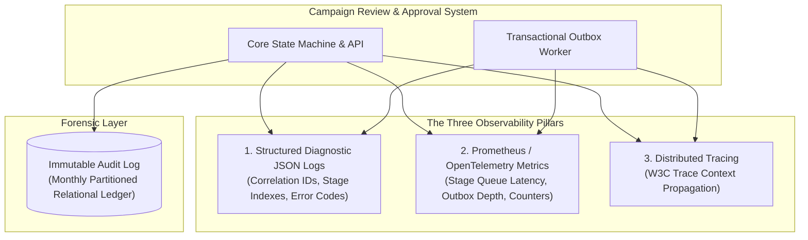

# System Observability, Diagnostic Logging & Audit Specification

> **Document Status:** Approved v1.0  
> **Last Updated:** 2026-11-01  
> **Owner:** Domain Research & Requirements Lead  
> **Traces to:** [`non-functional-requirements.md`](../01-problem-understanding/non-functional-requirements.md) (`NFR-012`, `NFR-013`, `NFR-016`, `NFR-017`), [`database-schema.md`](../06-data-design/database-schema.md), [`event-catalog.md`](../06-data-design/event-catalog.md)

---

## 1. Executive Summary & Observability Philosophy

Observability is a first-class architectural capability within the **Campaign Review & Approval Platform**, directly addressing **15% of the MAL4 Evaluation Rubric** (*Testing & Observability*).

In marketing platforms managing financial commitments and regulatory compliance, observability serves a dual purpose:
1. **Operational Telemetry:** Providing real-time diagnostic visibility into latency, bottlenecks, outbox dispatch queues, and network failures.
2. **Forensic Auditability:** Guaranteeing an immutable, non-repudiable audit ledger that proves mathematically to regulators (GDPR, SOX 404, FINRA 2210) who reviewed and authorized every campaign version.

---

## 2. The Three Pillars of Observability



---

## 3. Pillar 1: Structured Diagnostic JSON Logging (`NFR-016`)

All application logs emit single-line, structured JSON to `stdout` following the standardized schema below. This enables automated parsing by centralized logging aggregators (Elasticsearch, Loki, CloudWatch):

### 3.1 Standard Diagnostic Log Schema

| Field Name | Type | Description |
|:---|:---:|:---|
| `timestamp` | ISO-8601 UTC | Millisecond-precision server timestamp (`2026-11-01T14:35:10.123Z`). |
| `level` | String | Log level: `DEBUG`, `INFO`, `WARN`, `ERROR`, `FATAL`. |
| `service` | String | Service emitter name (`campaign-service`, `outbox-worker`). |
| `correlation_id` | UUID | End-to-end request tracing identifier propagated across mobile and backend. |
| `event_type` | String | Domain event or operation classifier. |
| `campaign_id` | UUID | Identifier of the campaign under evaluation. |
| `version` | Integer | Version number of the campaign snapshot. |
| `stage_index` | Integer | Current review stage (1=Creative, 2=Compliance, 3=Finance). |
| `actor_id` | UUID | Authenticated user executing the operation. |
| `outcome` | String | Execution result (`SUCCESS`, `REJECTED_409_CONFLICT`, `IDEMPOTENT_CACHE_HIT`). |
| `latency_ms` | Float | Server execution latency in milliseconds. |
| `details` | JSON Object | Contextual payload (e.g., error causes, diff summary, backoff attempt). |

---

### 3.2 Concrete Diagnostic Log Examples

#### Scenario A: Successful Multi-Stage Approval (Stage 1 Advance)
```json
{
  "timestamp": "2026-11-01T14:35:10.412Z",
  "level": "INFO",
  "service": "campaign-service",
  "correlation_id": "req-98f2-411a-82bc",
  "event_type": "STAGE_1_APPROVED",
  "campaign_id": "cmp-849204",
  "version": 1,
  "stage_index": 1,
  "actor_id": "usr-reviewer-creative-01",
  "outcome": "SUCCESS",
  "latency_ms": 28.4,
  "details": {
    "next_stage": 2,
    "next_role": "ComplianceReviewer",
    "snapshot_hash": "e3b0c44298fc1c149afbf4c8996fb92427ae41e4649b934ca495991b7852b855"
  }
}
```

#### Scenario B: Concurrent Review Conflict (`409 Conflict`)
```json
{
  "timestamp": "2026-11-01T14:35:11.002Z",
  "level": "WARN",
  "service": "campaign-service",
  "correlation_id": "req-71a4-92bd-110a",
  "event_type": "CONCURRENT_COLLISION",
  "campaign_id": "cmp-849204",
  "version": 1,
  "stage_index": 1,
  "actor_id": "usr-reviewer-creative-02",
  "outcome": "REJECTED_409_CONFLICT",
  "latency_ms": 11.2,
  "details": {
    "expected_version": 1,
    "actual_version": 2,
    "actual_stage": 2,
    "cause": "Campaign stage already advanced by Reviewer usr-reviewer-creative-01."
  }
}
```

#### Scenario C: Idempotent Request Deduplication Cache Hit
```json
{
  "timestamp": "2026-11-01T14:35:12.891Z",
  "level": "INFO",
  "service": "campaign-service",
  "correlation_id": "req-98f2-411a-82bc-retry",
  "event_type": "IDEMPOTENT_RETRY_HIT",
  "campaign_id": "cmp-849204",
  "version": 2,
  "stage_index": 2,
  "actor_id": "usr-reviewer-creative-01",
  "outcome": "IDEMPOTENT_CACHE_HIT",
  "latency_ms": 4.1,
  "details": {
    "idempotency_key": "uuid-9a8b-7c6d-4e2f",
    "cached_response_status": 200,
    "action": "Returned cached approval response; zero mutations executed."
  }
}
```

#### Scenario D: Material Change Invalidation Triggered
```json
{
  "timestamp": "2026-11-01T14:40:00.120Z",
  "level": "WARN",
  "service": "campaign-service",
  "correlation_id": "req-11ac-44ef-9011",
  "event_type": "MATERIAL_CHANGE_INVALIDATION",
  "campaign_id": "cmp-849204",
  "version": 2,
  "stage_index": 1,
  "actor_id": "usr-marketer-01",
  "outcome": "APPROVAL_REVOKED",
  "latency_ms": 34.8,
  "details": {
    "material_parameter": "budget_amount",
    "old_value": 25000.00,
    "new_value": 35000.00,
    "delta_percentage": 0.40,
    "action": "Prior approvals revoked; version bumped to v2; reset to Stage 1 Creative."
  }
}
```

#### Scenario E: Outbox Dispatch Retry & DLQ Routing
```json
{
  "timestamp": "2026-11-01T14:45:00.950Z",
  "level": "ERROR",
  "service": "outbox-worker",
  "correlation_id": "outbox-ev-48910",
  "event_type": "OUTBOX_DELIVERY_EXHAUSTED",
  "campaign_id": "cmp-849204",
  "version": 2,
  "stage_index": 1,
  "actor_id": "system",
  "outcome": "ROUTED_TO_DLQ",
  "latency_ms": 1205.0,
  "details": {
    "retry_attempt": 4,
    "target_channel": "FCM_PUSH",
    "last_error": "FCM Gateway HTTP 503 Service Unavailable",
    "action": "Outbox status marked FAILED; event routed to DLQ; core transaction unaffected."
  }
}
```

---

## 4. Pillar 2: Prometheus & OpenTelemetry Metrics

The platform exposes an authenticated `/metrics` endpoint scraped by Prometheus at 15-second intervals.

### 4.1 Business Domain Metrics

| Metric Name | Type | Labels | Description |
|:---|:---:|:---|:---|
| `campaign_transitions_total` | Counter | `from_state`, `to_state`, `stage_index` | Cumulative state transition volume across all campaigns. |
| `stage_approvals_total` | Counter | `stage_index`, `reviewer_role` | Approvals granted by specific stage gatekeepers. |
| `material_invalidations_total` | Counter | `parameter_changed` | Modifications triggering automated re-approval cycles. |
| `campaigns_in_flight` | Gauge | `state`, `stage_index` | Number of campaigns currently in a given review stage. |
| `review_stage_duration_seconds` | Histogram | `stage_index` | Time proposals spend pending review at each stage. |
| `scheduling_gate_checks_total` | Counter | `result` (`passed`, `mismatch`, `unapproved`) | Verification attempts at the scheduling gate. |

### 4.2 System & Runtime Metrics

| Metric Name | Type | Labels | Description |
|:---|:---:|:---|:---|
| `http_requests_total` | Counter | `method`, `endpoint`, `status` | Ingress HTTP traffic volume. |
| `http_request_duration_seconds` | Histogram | `method`, `endpoint` | Request execution latency distribution. |
| `idempotency_hits_total` | Counter | `endpoint` | Number of retried requests deduplicated cleanly. |
| `outbox_queue_depth` | Gauge | `status` | Count of pending outbox events awaiting dispatch. |
| `outbox_dispatch_latency_seconds` | Histogram | `event_type` | End-to-end latency from outbox commit to external dispatch. |
| `dlq_messages_total` | Counter | `channel` | Total events routed to the Dead Letter Queue. |
| `db_connection_pool_active` | Gauge | `pool` | Active database connections in use. |

---

## 5. Pillar 3: Distributed Tracing

The platform implements **W3C Distributed Tracing** using the OpenTelemetry SDK. Trace contexts (`traceparent` header) propagate across:
1. Mobile App Client $\rightarrow$ API Gateway
2. API Controller $\rightarrow$ Relational Database Transactions
3. Outbox Event Commit $\rightarrow$ Background Dispatcher Worker
4. Worker Dispatch $\rightarrow$ Downstream Notification Gateways

This allows operators to trace a single campaign submission from the mobile button click through to the reviewer's push notification in a unified trace timeline.

---

## 6. Immutable Audit Trail & Forensic Lineage (`NFR-012`)

The `audit_log` table serves as the legal system of record:
- **Append-Only Invariant:** No `UPDATE` or `DELETE` permissions are granted on the `audit_log` table to any user or application role.
- **Monthly Partitioning:** Tables are partitioned by month for maintenance and performant historical querying.
- **Cryptographic Lineage:** Every audit record binds the actor, timestamp, previous state, new state, and the canonical SHA-256 snapshot hash.
- **Audit Verification Query:**
  ```sql
  -- Reconstruct complete lifecycle timeline for legal/compliance audit
  SELECT 
      created_at, 
      action, 
      previous_state, 
      new_state, 
      stage_index, 
      actor_id, 
      snapshot_hash,
      details
  FROM audit_log 
  WHERE campaign_id = :campaign_id 
  ORDER BY created_at ASC;
  ```

---

## 7. Health Monitoring & Operational Alerting Rules (`NFR-017`)

### 7.1 Health Probes
- **Liveness Probe (`GET /health/liveness`):** Returns `200 OK` if the web service container is alive.
- **Readiness Probe (`GET /health/readiness`):** Verifies active connectivity to:
  1. PostgreSQL Primary Database (`SELECT 1;`)
  2. Outbox Queue Depth ($< 500$ pending events)
  3. Disk and Memory utilization ($< 90\%$)

### 7.2 Critical Operational Alerting Rules

| Alert Name | Condition | Severity | Channel | Action |
|:---|:---|:---:|:---:|:---|
| **`DLQMessagesDetected`** | `increase(dlq_messages_total[5m]) > 0` | **Critical** | PagerDuty | Inspect failed payloads in DLQ; investigate provider outages. |
| **`OutboxBacklogSpike`** | `outbox_queue_depth{status='PENDING'} > 100` for 5m | **High** | Slack Ops | Scale outbox worker replicas. |
| **`ReviewQueueStall`** | `max(review_stage_duration_seconds) > 172800` (48h) | **Medium** | Email / Ops | Send reminder escalations to assigned review gatekeepers. |
| **`ConcurrentCollisionSpike`** | `rate(http_requests_total{status='409'}[5m]) > 5` | **Medium** | Slack Ops | Investigate concurrent mobile submission patterns. |
| **`DatabaseHighConnections`** | `db_connection_pool_active / db_pool_max > 0.85` | **High** | PagerDuty | Scale connection pooler or optimize slow queries. |

---

## 8. Defensible Architectural Decisions in Observability

### 8.1 In-Database Relational Audit vs. External Logging Service (Datadog/Splunk)
- **Chosen Approach:** Relational `audit_log` table committed within the same ACID transaction as the state change.
- **Why Chosen:** SOX 404 Section 8 and FINRA 2210 regulatory audits require mathematically non-repudiable audit trails. External log shipping services can drop logs during network partitions or rate limiting. An in-database audit entry is ACID-guaranteed to commit if and only if the business decision commits.
- **Why Not External-Only Logs:** Log drops during infrastructure outages destroy the legal compliance chain.
