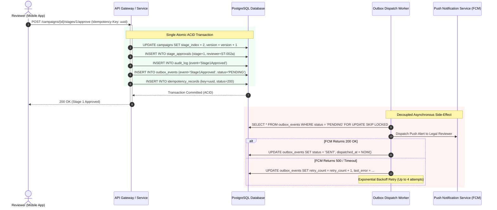
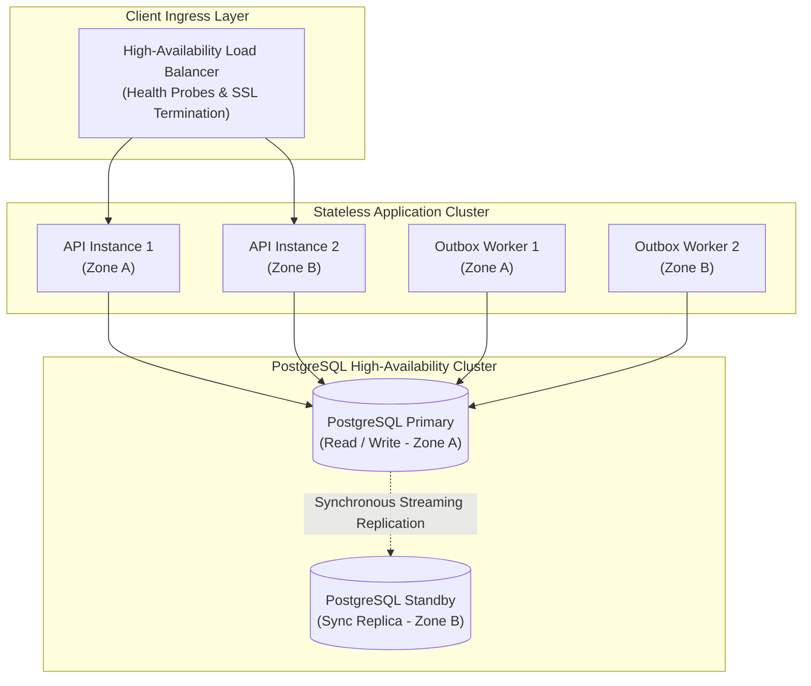

# System Reliability & Fault Tolerance Specification

> **Document Status:** Approved v1.0  
> **Last Updated:** 2026-11-01  
> **Owner:** Domain Research & Requirements Lead  
> **Traces to:** [`non-functional-requirements.md`](../01-problem-understanding/non-functional-requirements.md) (`NFR-001`, `NFR-002`, `NFR-004`, `NFR-005`, `NFR-006`, `NFR-007`), [`failure-recovery.md`](../04-workflows/failure-recovery.md), [`database-schema.md`](../06-data-design/database-schema.md)

---

## 1. Executive Summary & Core Reliability Philosophy

Enterprise marketing applications operating on mobile devices face volatile network conditions, cellular timeouts, and third-party SaaS dependencies. A robust architecture must guarantee data consistency and system availability despite these real-world disruptions.

The platform's reliability architecture is built upon three foundational tenets:
1. **Core State Isolation:**authoritative business state transitions (e.g., stage approvals, scheduling clearance) must execute within atomic database boundaries and **never** depend synchronously on external network services.
2. **End-to-End Idempotency:** Every state-mutating API call accepts a client-generated UUID token (`Idempotency-Key`), guaranteeing safe automatic retries over unstable mobile connections.
3. **Deterministic Conflict Resolution:** Concurrent updates serialize via database-level **Optimistic Concurrency Control (OCC)** on `(version, stage_index)`, ensuring zero silent overwrites or split-brain approval states.

---

## 2. Service Level Objectives (SLOs) & Service Level Indicators (SLIs)

| Objective | Target (SLO) | Indicator (SLI) | Measurement Window | Action on Breach |
|:---|:---:|:---|:---:|:---|
| **Core Availability** | 99.9% uptime | $\frac{\text{Successful HTTP 2xx/4xx Requests}}{\text{Total Requests (excl. 5xx)}}$ | Monthly rolling | Automated container failover; PagerDuty incident |
| **Stage Transition Success** | 99.99% integrity | $\frac{\text{Valid State Transitions}}{\text{Attempted Valid Transitions}}$ | Continuous | Critical alert; transaction auto-rollback |
| **Review Write Latency** | $< 350\text{ ms}$ (p95) | HTTP POST duration for `/stages/:k/approve` | 5-minute rolling | Dynamic connection pool expansion |
| **Notification Delivery** | 99.5% within 60s | Time from Outbox insertion to external dispatch | Hourly rolling | Outbox poller auto-scaling; DLQ alert |
| **Idempotency Accuracy** | 100% duplicate-free | Duplicate records generated per 10k retries | Continuous | Critical data integrity alert |

---

## 3. Core Reliability Mechanisms

### 3.1 Transactional Outbox Pattern for Blast-Radius Isolation (`NFR-005`)
Dual-writes (e.g., updating a database row and publishing to an external notification queue) suffer from distributed failure modes. If the database commit succeeds but the network call to FCM/SendGrid fails, the notification is lost. If the notification succeeds but the database rolls back, phantom alerts are sent.

The platform eliminates dual-write failures by using the **Transactional Outbox Pattern**:



- **Guaranteed Isolation:** Even if FCM or SendGrid is completely offline for hours, 100% of campaign approvals succeed and commit cleanly.
- **At-Least-Once Delivery:** Events remain in `outbox_events` until successfully acknowledged.

### 3.2 Exponential Backoff & Dead Letter Queue (DLQ) Schedule
When outbound notification delivery encounters intermittent failures, the background dispatcher applies an exponential backoff with full jitter to prevent thundering herd spikes on downstream providers:

$$\text{Retry Delay} = \min\left(\text{Max Delay}, 2^{\text{attempt}} \times \text{Base Delay}\right) + \text{jitter}$$

| Attempt | Base Delay | Jitter Range | Total Delay Window | Action on Failure |
|:---:|:---:|:---:|:---:|:---|
| **1** | $1\text{ s}$ | $0\text{--}500\text{ ms}$ | $1.0\text{--}1.5\text{ s}$ | Re-enqueue in worker pool |
| **2** | $4\text{ s}$ | $0\text{--}1000\text{ ms}$ | $4.0\text{--}5.0\text{ s}$ | Re-enqueue in worker pool |
| **3** | $16\text{ s}$ | $0\text{--}2000\text{ ms}$ | $16.0\text{--}18.0\text{ s}$ | Re-enqueue in worker pool |
| **4** | $64\text{ s}$ | $0\text{--}5000\text{ ms}$ | $64.0\text{--}69.0\text{ s}$ | Final retry attempt |
| **Exhaustion** | — | — | — | Mark `FAILED`; route to **Dead Letter Queue (DLQ)**; emit PagerDuty alert |

---

### 3.3 Optimistic Concurrency Control (Version Tokens) (`NFR-001`, `NFR-003`)
To prevent concurrent review collisions and lost updates without blocking database connections:
- Every mutating request must provide `expected_version` and `expected_stage`.
- The database update uses an atomic conditional clause:
  ```sql
  UPDATE campaigns 
  SET 
      stage_index = :new_stage,
      version = version + 1,
      updated_at = CURRENT_TIMESTAMP
  WHERE 
      id = :campaign_id 
      AND version = :expected_version 
      AND stage_index = :expected_stage
      AND state = 'PENDING_REVIEW';
  ```
- **Collision Handling:** If another reviewer committed first, rows affected is `0`. The transaction immediately rolls back and returns `409 Conflict`. The client app refreshes and displays the latest stage without data corruption.

---

### 3.4 Mobile Offline Resilience & Reconciliation (`NFR-004`)
- **Offline Drafting:** Marketers can draft campaign proposals in local SQLite storage while disconnected.
- **Server Authority on State Transitions:** State-changing operations (`SUBMIT`, `STAGE_ADVANCE`, `REQUEST_CHANGES`, `SCHEDULE`) require server connectivity.
- **Reconnection Sync:** When re-establishing connectivity, the client submits the working draft with an `If-Match: version` header. If the remote version matches, the changes sync seamlessly. If a remote update occurred while offline, the app highlights the conflict for manual reconciliation.

---

## 4. Redundancy & High Availability Architecture



1. **Stateless API Services:** API nodes carry zero in-memory session state, allowing instant horizontal scaling and zero-downtime rolling deployments.
2. **Multi-AZ Synchronous Replication:** PostgreSQL primary streams writes synchronously to a hot standby in an independent availability zone with automated Patroni/PgBouncer failover (RTO $< 30$ seconds, RPO $= 0$).
3. **Connection Pooling:** PgBouncer enforces transaction-level connection pooling to prevent connection exhaustion during mobile connection bursts.

---

## 5. Disaster Recovery & Data Protection

| Metric | Target | Implementation Mechanism |
|:---|:---:|:---|
| **Recovery Point Objective (RPO)** | $0\text{ seconds}$ | Multi-AZ synchronous streaming replication for committed transactions. |
| **Recovery Time Objective (RTO)** | $< 30\text{ seconds}$ | Automated database health probe with Patroni leader election and VIP switch. |
| **Backup Cadence** | Hourly + Daily | Hourly WAL log shipping to immutable S3 buckets + Daily full automated snapshot. |
| **Backup Verification** | Weekly | Automated sandbox restore test verifying snapshot hash digests. |

---

## 6. Defensible Architectural Trade-offs in Reliability

### 6.1 Optimistic Concurrency Control vs. Pessimistic Row Locking
- **Chosen Approach:** Optimistic Concurrency Control using integer `version` vectors.
- **Why Chosen:** Mobile clients operating over cellular networks experience unpredictable latency and disconnections. Pessimistic row locks (`SELECT FOR UPDATE`) risk locking database rows indefinitely if a user loses connection mid-review, starving the connection pool and freezing other reviewers.
- **Why Not Pessimistic Locking:** Severe deadlock vulnerability, connection pool exhaustion, poor mobile user experience.

### 6.2 Transactional Outbox vs. Two-Phase Commit (2PC) / XA Transactions
- **Chosen Approach:** Local relational Outbox table polled by asynchronous background workers.
- **Why Chosen:** Guarantees 100% blast-radius isolation without introducing distributed transaction coordinators. Extremely simple, debuggable, and reliable.
- **Why Not 2PC / XA:** Extremely brittle across heterogeneous networks, high blocking latency, and unsupported by modern cloud SaaS providers (FCM, SendGrid).
