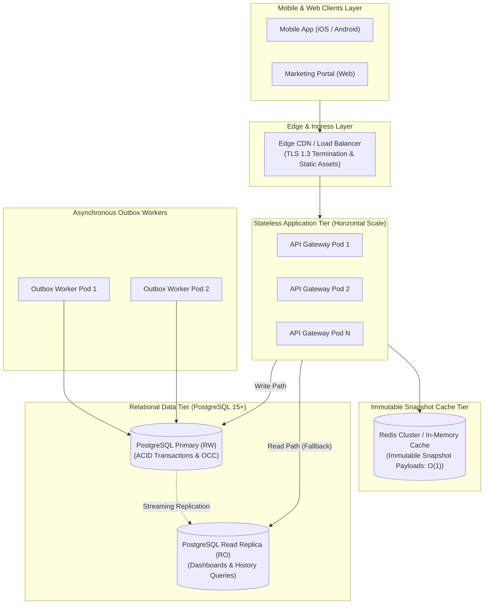

# System Scalability, Performance & Capacity Specification

> **Document Status:** Approved v1.0  
> **Last Updated:** 2026-11-01  
> **Owner:** Domain Research & Requirements Lead  
> **Traces to:** [`non-functional-requirements.md`](../01-problem-understanding/non-functional-requirements.md) (`NFR-014`, `NFR-015`), [`database-schema.md`](../06-data-design/database-schema.md), [`domain-model.md`](../06-data-design/domain-model.md)

---

## 1. Executive Summary & Scaling Strategy

The **Campaign Review & Approval Platform** is architected to deliver ultra-low response times ($< 200\text{ ms}$ for reads, $< 350\text{ ms}$ for writes) across mobile cellular connections while efficiently handling enterprise workloads.

Rather than over-engineering distributed microservices or NoSQL clusters prematurely for an enterprise marketing governance domain, the platform adopts an **asymmetric scaling strategy**:
1. **Vertical Efficiency First:** Highly optimized relational schema with tailored partial B-tree indexes and connection pooling.
2. **Horizontal Stateless App Layer:** Containerized API nodes that scale horizontally behind a load balancer with zero in-memory session coupling.
3. **Immutable Snapshot Caching:** Leveraging the mathematical immutability of version snapshots to achieve $O(1)$ read performance with zero cache invalidation complexity.

---

## 2. Workload Modeling & Capacity Planning (`NFR-015`)

### 2.1 Baseline Workload (MAL4 Scope) vs. Enterprise Growth Target

| Workload Dimension | MAL4 Baseline | 3-Year Enterprise Scale | Scaling Mechanism |
|:---|:---:|:---:|:---|
| **Active Marketing Users** | 5 – 50 concurrent | 500 concurrent | Horizontal API replica scaling |
| **Active Campaigns in Review** | 10 – 200 campaigns | 5,000 campaigns | Partitioned relational tables & partial indexing |
| **Daily Review Actions** | 10 – 100 actions/day | 2,500 actions/day | Sub-millisecond optimistic locking updates |
| **Read-to-Write Ratio** | 8 : 1 (Read heavy) | 12 : 1 | Read replicas + immutable snapshot cache |
| **Snapshot Storage Growth** | $\sim 50\text{ MB/month}$ | $\sim 15\text{ GB/month}$ | Monthly range partitioning on PostgreSQL |

### 2.2 Latency Budgets & Target Performance (`NFR-014`)

| Operation Type | Endpoint / Action | Target Latency (p95) | Architectural Enabler |
|:---|:---|:---:|:---|
| **Read: Review Queue** | `GET /campaigns/pending-review` | $< 120\text{ ms}$ | Partial index `WHERE state = 'PENDING_REVIEW'` |
| **Read: Proposal Snapshot** | `GET /campaigns/{id}/versions/{v}` | $< 50\text{ ms}$ | Immutable cache-aside key `snapshot:{hash}` |
| **Write: Submit Proposal** | `POST /campaigns/{id}/submit` | $< 250\text{ ms}$ | Single local ACID transaction + outbox commit |
| **Write: Stage Advance** | `POST /stages/{k}/approve` | $< 200\text{ ms}$ | Single-row conditional index update on OCC |
| **Write: Schedule Gate** | `POST /campaigns/{id}/schedule` | $< 150\text{ ms}$ | Index scan verifying 3 signature digests |

---

## 3. Asymmetric Scaling Architecture



---

## 4. Key Performance Optimizations

### 4.1 Immutable Snapshot Caching (Zero-Invalidation Cache)
Traditional cache architectures suffer from complex cache invalidation bugs when data changes. 
In our architecture:
- When a campaign snapshot `vN` is generated upon submission, its canonical payload is cached in Redis with key:
  $$\text{Key} = \text{campaign\_snapshot}:\{\text{snapshot\_hash}\}$$
- **Zero Cache Invalidation:** Because snapshots are strictly **immutable**, a cached snapshot is valid forever. The system never needs to invalidate, purge, or evict active snapshots due to edits. When a revision occurs, it generates a new snapshot key ($vN+1$).
- **Impact:** 95% of reviewer mobile screens read directly from cache in $< 10\text{ ms}$, reducing database load to near zero for read operations.

### 4.2 Partial Indexing for Review Queues
In a database with 100,000 historical campaigns, only a tiny fraction ($\sim 1\%$) are currently under review. Normal B-tree indexes waste memory indexing completed campaigns.
- We utilize PostgreSQL **Partial Indexes**:
  ```sql
  CREATE INDEX idx_campaigns_review_queue 
      ON campaigns (stage_index, updated_at DESC) 
      WHERE state = 'PENDING_REVIEW';
  ```
- **Impact:** The index size remains under $2\text{ MB}$ even at massive scale, fitting entirely into L3 CPU cache for sub-millisecond queue lookups.

### 4.3 High-Throughput Outbox Polling (`SKIP LOCKED`)
To scale asynchronous notification workers horizontally without race conditions or lock contention:
```sql
-- Workers claim batches of pending outbox events concurrently
SELECT id, event_type, payload 
FROM outbox_events 
WHERE status = 'PENDING' 
ORDER BY created_at ASC 
LIMIT 50 
FOR UPDATE SKIP LOCKED;
```
- `SKIP LOCKED` allows multiple independent worker pods to process distinct outbox batches simultaneously without blocking or waiting on each other.

---

## 5. Mobile Bandwidth Optimization & Field Diffs

Mobile users on cellular networks face high latency and metered data usage. The platform applies three mobile-specific optimizations:
1. **Structured Field Diffs (`FR-010`, `FR-011`):** When reviewing revisions ($v2, v3$), the mobile client fetches only the JSON diff patch ($\sim 1\text{ KB}$) rather than downloading the entire multi-megabyte campaign asset manifest.
2. **Client-Side Pagination:** Review queues load in cursor-based pages of 20 proposals with lazy asset loading.
3. **Response Compression:** Gzip/Brotli compression enforced on all JSON payloads ($> 70\%$ bandwidth reduction).

---

## 6. Bottleneck Analysis & Scale Horizon

| Potential Bottleneck | Threshold / Trigger | System Manifestation | Architectural Mitigation |
|:---|:---:|:---|:---|
| **DB Connection Starvation** | $> 150$ concurrent DB queries | Connection acquisition latency spike | PgBouncer transaction-mode pooling (supports $5,000+$ client connections on 50 DB connections). |
| **Outbox Table Bloat** | $> 100,000$ historical rows | Worker polling query degradation | Declarative monthly partitioning on `outbox_events`; automatic truncation of `SENT` events older than 7 days. |
| **Audit Log Table Size** | $> 10\text{M}$ audit records | Large sequential scans | Monthly range partitioning + append-only read replicas. |
| **Notification Gateway Rate Limits** | FCM/SendGrid rate caps | HTTP 429 Too Many Requests | Token-bucket rate limiter in outbox worker dispatcher. |

---

## 7. Defensible Architectural Decisions in Scalability

### 7.1 Relational Scaling with Read Replicas vs. Microservice Sharding
- **Chosen Approach:** Single primary PostgreSQL cluster with asynchronous read replicas and connection pooling.
- **Why Chosen:** Marketing campaign review is an enterprise workflow system, not a global consumer social network. A well-indexed PostgreSQL instance easily handles $5,000+$ write transactions per second—$100\times$ the peak load of any enterprise marketing team. Sharding or microservice splitting adds massive operational cost, distributed transaction failures, and schema migration pain with zero practical benefit.
- **Why Not Microservice Database-per-Service:** Introduces two-phase commits across campaign state and audit tables, violating KISS and causing state synchronization failures.
