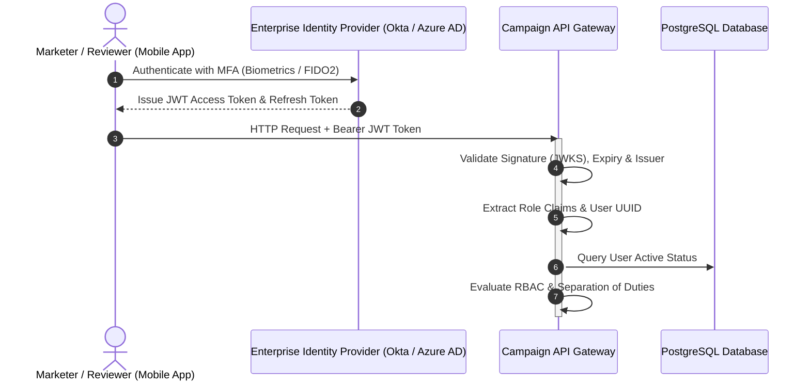

# System Security, Access Control & Compliance Specification

> **Document Status:** Approved v1.0  
> **Last Updated:** 2026-11-01  
> **Owner:** Domain Research & Requirements Lead  
> **Traces to:** [`non-functional-requirements.md`](../01-problem-understanding/non-functional-requirements.md) (`NFR-008`, `NFR-009`, `NFR-010`, `NFR-011`), [`stakeholders.md`](../01-problem-understanding/stakeholders.md), [`approval-workflow.md`](../04-workflows/approval-workflow.md), [`database-schema.md`](../06-data-design/database-schema.md)

---

## 1. Executive Summary & Security Philosophy

The **Campaign Review & Approval Platform** serves as the central governance gateway controlling corporate brand integrity, regulatory advertising compliance, and multi-thousand-dollar budget authorizations.

Security cannot be treated as a perimeter firewall or a client-side filter; it must be **deeply embedded within the core domain model**. 

The security architecture guarantees:
1. **Zero Trust Authorization:** Every mutating request is authenticated and verified server-side against role capabilities and aggregate state before execution.
2. **Strict Separation of Duties (Anti-Self-Approval):** Authors of campaign proposals are structurally prohibited from reviewing, approving, or modifying their own campaigns while in review (`FR-018`, `NFR-010`).
3. **Cryptographic Non-Repudiation:** Review approvals and scheduling releases are bound to SHA-256 payload digests, preventing post-approval tampering and data drift.

---

## 2. Authentication & Identity Architecture (`NFR-008`)

Authentication is delegated to an enterprise Identity Provider (IdP) via **OAuth 2.0 and OpenID Connect (OIDC)**:



### 2.1 Standard JWT Token Claims
Every incoming Bearer token must carry standard OIDC claims:
```json
{
  "iss": "https://auth.martech-enterprise.com/",
  "sub": "usr-8f4b-2201-9a1c-338b",
  "email": "sarah.compliance@enterprise.com",
  "roles": ["ComplianceReviewer"],
  "tenant_id": "org-global-marketing",
  "iat": 1793520000,
  "exp": 1793523600
}
```

---

## 3. Role-Based Access Control (RBAC) Matrix (`NFR-009`)

Permissions are strictly enforced at the API controller and domain model boundaries:

| Permission / Action | Marketer (`ST-001`) | Creative Reviewer (`ST-002a`) | Compliance Officer (`ST-002b`) | Finance Approver (`ST-002c`) | Administrator (`ST-003`) |
|:---|:---:|:---:|:---:|:---:|:---:|
| **Create Campaign Draft** | ✅ | ❌ | ❌ | ❌ | ✅ |
| **Edit Working Draft** | ✅ *(Owner)* | ❌ | ❌ | ❌ | ❌ |
| **Submit Proposal (`FR-004`)** | ✅ *(Owner)* | ❌ | ❌ | ❌ | ❌ |
| **Withdraw Submission (`FR-005`)** | ✅ *(Owner)* | ❌ | ❌ | ❌ | ❌ |
| **Stage 1: Creative Approve** | ❌ | ✅ *(Non-Owner)* | ❌ | ❌ | ❌ |
| **Stage 2: Compliance Approve**| ❌ | ❌ | ✅ *(Non-Owner)* | ❌ | ❌ |
| **Stage 3: Finance Sign-off** | ❌ | ❌ | ❌ | ✅ *(Non-Owner)* | ❌ |
| **Request Changes / Reject** | ❌ | ✅ *(Stage 1)* | ✅ *(Stage 2)* | ✅ *(Stage 3)* | ❌ |
| **Trigger Scheduling (`FR-012`)**| ✅ *(Owner)* | ❌ | ❌ | ❌ | ✅ |
| **View Audit Logs (`FR-015`)** | Own Campaigns | Assigned Stage | Assigned Stage | Assigned Stage | **All Campaigns** |
| **Manage Users & Workflows** | ❌ | ❌ | ❌ | ❌ | ✅ |

---

## 4. Strict Separation of Duties (Anti-Self-Approval Enforcement) (`NFR-010`)

### 4.1 Regulatory Mandate
- **SOX 404 Section 8:** Requires independent principal review of corporate commercial commitments; authors cannot approve their own expenditure.
- **FINRA Rule 2210:** Requires designated registered principals to review and approve retail communications independently of the creative creator.

### 4.2 Multi-Layered Enforcement Architecture
1. **API Guard Filter (Layer 1):**
   ```python
   if request.user.id == campaign.submitted_by_id:
       log.warn("Self-review attempt blocked", actor=request.user.id, campaign=campaign.id)
       raise ForbiddenException("Separation of duties violation: Submitter cannot review their own campaign.")
   ```
2. **Domain Aggregate Invariant (Layer 2):**
   The `Campaign` aggregate root validates that `actor.id != submitted_by_id` before executing any stage progression method.
3. **Database Constraint / Trigger (Layer 3):**
   ```sql
   -- Database-level defense against rogue scripts or direct DB access
   CREATE OR REPLACE FUNCTION verify_anti_self_approval()
   RETURNS TRIGGER AS $$
   BEGIN
       IF EXISTS (
           SELECT 1 FROM campaigns 
           WHERE id = NEW.campaign_id AND submitted_by_id = NEW.reviewer_id
       ) THEN
           RAISE EXCEPTION 'Separation of duties violation: Submitter cannot sign off on own campaign.';
       END IF;
       RETURN NEW;
   END;
   $$ LANGUAGE plpgsql;

   CREATE TRIGGER trg_anti_self_approval
       BEFORE INSERT ON stage_approvals
       FOR EACH ROW EXECUTE FUNCTION verify_anti_self_approval();
   ```

---

## 5. Data Protection & Cryptography

### 5.1 Encryption Standards
- **Data in Transit:** Enforced TLS 1.3 with HSTS (`Strict-Transport-Security: max-age=63072000; includeSubDomains; preload`). Deprecated TLS versions ($< 1.2$) and weak cipher suites are rejected.
- **Data at Rest:** All relational databases, partition tables, and backup storage use AES-256 encryption managed via cloud KMS keys with annual key rotation.

### 5.2 Cryptographic Snapshot Integrity
- Every campaign submission produces a canonical JSON representation formatted according to RFC 8785 (JSON Canonicalization Scheme).
- The system computes the **SHA-256 digest**:
  $$\text{snapshot\_hash} = \text{SHA-256}(\text{CanonicalJSON}(\text{payload}))$$
- Every stage approval record stores this hash. When the campaign clears the scheduling gate, the system recalculates the hash against the current proposal. Any modified bit results in a hash divergence, blocking release.

---

## 6. STRIDE Threat Model & Mitigations

| Threat Category | Potential Attack Vector | System Impact | Implemented Mitigation |
|:---|:---|:---|:---|
| **Spoofing** | Attacker spoofs reviewer identity using stolen session token. | Unauthorized approval granted. | Short-lived JWTs (15 min), asymmetric RS256 signature verification, IdP MFA enforcement. |
| **Tampering** | Marketer modifies campaign budget from \$10k to \$100k post-approval. | Unreviewed commercial release. | **Material Change Invalidation Engine:** Modifying approved copy revokes approvals and resets pipeline (`FR-014`). |
| **Repudiation** | Reviewer claims they never approved a controversial ad. | Inability to prove accountability. | Immutable, append-only `audit_log` binding reviewer ID, timestamp, IP, and cryptographic snapshot hash (`NFR-012`). |
| **Information Disclosure** | Competitor or unauthorized employee reads unreleased campaign plans. | Leak of corporate strategy. | Tenant isolation, strict role-based row-level security (`RLS`), and encryption at rest. |
| **Denial of Service** | Malicious client floods review endpoints to starve database. | Review operations unavailable. | Token bucket rate limiting (100 req/min per user), PgBouncer connection pooling, optimistic concurrency. |
| **Elevation of Privilege** | Marketer alters client payload to inject `role: FinanceApprover`. | Self-authorization of ad spend. | Zero client trust: Roles extracted exclusively from verified server-side JWT claims signed by IdP. |

---

## 7. Regulatory Compliance Matrix

| Regulation / Standard | Domain Requirement | System Implementation |
|:---|:---|:---|
| **SOX 404 (Section 8)** | Segregation of duties for financial commitments; delegation of authority (DOA). | Stage 3 Finance approval gate (`ST-002c`); database trigger prohibiting self-approval; audit trail. |
| **GDPR (Articles 6 & 7)** | Proof of lawful basis and opt-in consent for targeted messaging. | Stage 2 Compliance gate (`ST-002b`); audience criteria review; immutable consent disclaimer snapshots. |
| **CAN-SPAM Act** | Mandatory opt-out mechanisms and physical postal disclosures. | Automated field validation on submission (`FR-004`); Stage 2 compliance audit before release. |
| **FINRA Rule 2210** | Independent principal pre-approval of retail advertising communications. | Stage 1 Creative + Stage 2 Legal gates; cryptographic snapshot non-repudiation. |

---

## 8. Defensible Architectural Trade-offs in Security

### 8.1 Server-Side Enforcement vs. Client-Side Role Checks
- **Chosen Approach:** All RBAC and separation of duties checks are enforced strictly in the API controllers, domain aggregate roots, and database triggers.
- **Why Chosen:** Client-side checks (e.g., hiding an "Approve" button in the Flutter UI) are purely cosmetic and easily bypassed via curl, Postman, or network proxies. Server-side enforcement provides mathematically airtight security.
- **Why Not Client-Only Checks:** Fatal security vulnerability.

### 8.2 Non-Configurable Separation of Duties
- **Chosen Approach:** Hardcoded invariant prohibiting self-approval (`submitted_by_id != reviewer_id`) with zero override options in UI or API.
- **Why Chosen:** Allows the architecture to pass SOX and FINRA external audits without qualifying caveats. In enterprise governance, self-approval exceptions represent the #1 vector for fraudulent spend commitments.
- **Why Not Configurable Policy Toggle:** Toggles create audit loopholes and invite social engineering pressure on administrators during tight launch deadlines.
