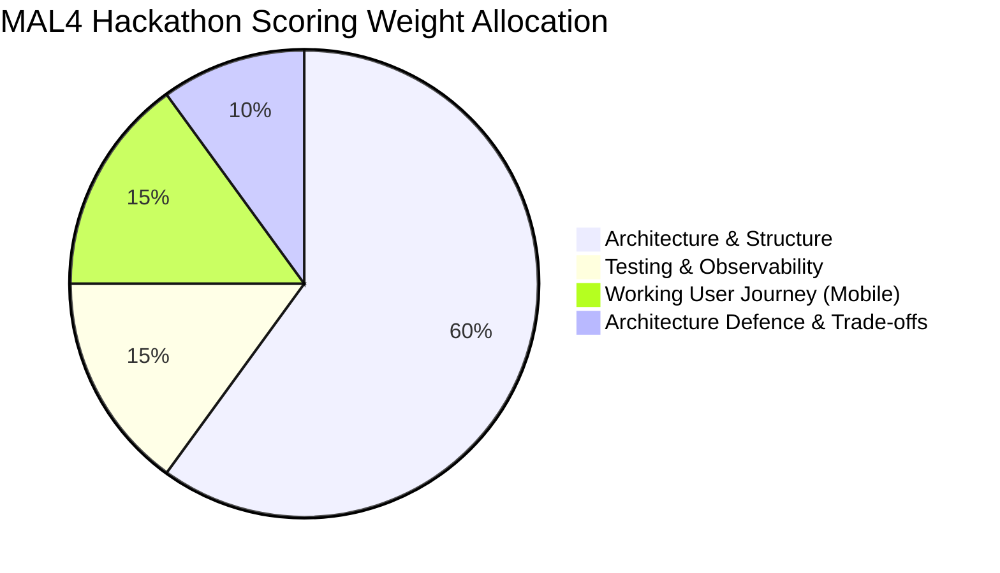

# Requirements, Architecture & Verification Traceability Matrix

> **Document Status:** Approved v1.0  
> **Last Updated:** 2026-11-01  
> **Owner:** Domain Research & Requirements Lead  
> **Traces to:** All sections in `docs/01-problem-understanding/`, `docs/04-workflows/`, `docs/06-data-design/`, and `docs/07-quality-attributes/`

---

## 1. Executive Summary & Traceability Governance

This Traceability Matrix serves as the single source of truth connecting business drivers, functional capabilities, quality attribute requirements, data design entities, workflows, and test verification methods for the **MAL4 MarTech Campaign Review & Approval Platform**.

It provides complete forward and backward traceability across the entire engineering lifecycle, directly addressing the MAL4 scoring dimensions:
- **Structure & boundaries (15%)**
- **Data & state management (15%)**
- **Testing & observability (15%)**
- **Failure & recovery handling (10%)**
- **Architecture defence (10%)**

---

## 2. Functional Requirements Traceability Matrix (`FR-001` to `FR-019`)

| Req ID | Requirement Summary | Stakeholders | Owning Workflow | Domain Aggregate / DB Table | Quality Attribute | Verification Method |
|:---:|:---|:---:|:---|:---|:---:|:---|
| **`FR-001`** | Campaign Creation & Drafting | `ST-001` (Marketer) | `campaign-lifecycle.md` §4.1 | `Campaign` / `campaigns` | Usability, Data Integrity | Unit test: `test_create_draft_campaign()` |
| **`FR-002`** | Campaign Parameter Editing | `ST-001` (Marketer) | `campaign-lifecycle.md` §2.1 | `Campaign` / `campaigns` | Concurrency, OCC | Unit test: `test_concurrent_draft_edit()` |
| **`FR-003`** | Soft Archival / Deletion | `ST-001`, `ST-003` | `campaign-lifecycle.md` §2.1 | `Campaign` / `campaigns` | Auditability | DB test: soft delete preserves audit log |
| **`FR-004`** | Submit Proposal for Review | `ST-001` (Marketer) | `user-journey-flow.mmd` Phase 1 | `CampaignSnapshot` / `campaign_snapshots` | Security, Integrity | Integration test: `test_submit_locks_snapshot()` |
| **`FR-005`** | Withdraw Submission | `ST-001` (Marketer) | `approval-workflow.md` §4 | `Campaign` / `campaigns` | Consistency | Integration test: `test_withdraw_before_review()` |
| **`FR-006`** | Multi-Stage Review Progression | `ST-002a`, `ST-002b` | `approval-workflow.md` §3 | `StageApproval` / `stage_approvals` | Reliability, Security | Integration test: `test_stage1_to_stage2_advance()` |
| **`FR-007`** | Finance Sign-off / Full Approval | `ST-002c` (Finance) | `approval-workflow.md` §3.3 | `StageApproval` / `campaigns` | Compliance, Auditability | Integration test: `test_stage3_final_approval()` |
| **`FR-008`** | Rejection Decision | `ST-002a/b/c` | `approval-workflow.md` §3.5 | `ReviewDecision` / `review_decisions` | Governance | Integration test: `test_rejection_terminates_cycle()` |
| **`FR-009`** | Request Changes Decision | `ST-002a/b/c` | `approval-workflow.md` §3.4 | `ReviewDecision` / `review_decisions` | Usability, Integrity | Integration test: `test_request_changes_attaches_notes()` |
| **`FR-010`** | Campaign Revision & Resubmission | `ST-001` (Marketer) | `revision-workflow.md` §2.1 | `CampaignSnapshot` ($vN+1$) | Traceability, Integrity | Integration test: `test_resubmit_creates_v2_resets_stage1()` |
| **`FR-011`** | Feedback Visibility & Diffing | `ST-001`, `ST-002a/b/c`| `revision-workflow.md` §5 | `ReviewDecision` / UI | Usability, Observability | UI test: structured field diff rendering |
| **`FR-012`** | Scheduling Gate Enforcement | `ST-001`, `ST-003` | `campaign-lifecycle.md` §4.8 | `Campaign` / `campaigns` | Security, Governance | Integration test: `test_scheduling_gate_verifies_signatures()` |
| **`FR-013`** | Immutable Version Snapshots | `ST-001`, `ST-002a/b/c`| `revision-workflow.md` §3 | `CampaignSnapshot` / `campaign_snapshots` | Cryptographic Integrity | Unit test: `test_snapshot_sha256_immutable()` |
| **`FR-014`** | Material Change Invalidation | `ST-001`, `ST-005` | `revision-workflow.md` §4 | `Campaign` / `stage_approvals` | Compliance, SOX 404 | Integration test: `test_budget_increase_invalidates_approval()` |
| **`FR-015`** | Immutable Audit Logging | `ST-003`, `ST-005` | `observability.md` §6 | `audit_log` (Partitioned) | Auditability, Non-Repudiation | DB test: `INSERT` succeeds; `UPDATE`/`DELETE` blocked |
| **`FR-016`** | Approval History Timeline | `ST-002`, `ST-003` | `observability.md` §6 | `audit_log` / Query Engine | Observability | API test: query full timeline by `campaign_id` |
| **`FR-017`** | Role-Based Access Control | All Stakeholders | `security.md` §3 | `users` / RBAC Middleware | Security | Security test: Marketer blocked from `/approve` |
| **`FR-018`** | Anti-Self-Approval Enforcement | `ST-001`, `ST-002` | `security.md` §4 | Domain Aggregate + DB Trigger | Compliance, SOX 404 | Unit + DB test: Submitter blocked from self-review |
| **`FR-019`** | Decoupled Lifecycle Notifications | All Stakeholders | `failure-recovery.md` §3.2 | `outbox_events` / Dispatcher | Reliability, Resilience | Chaos test: Outbox succeeds during FCM outage |

---

## 3. Non-Functional Requirements Traceability Matrix (`NFR-001` to `NFR-017`)

| NFR ID | Category | Requirement | Target Metric / Bound | Implementation Mechanism | Traceable Documents |
|:---:|:---|:---|:---:|:---|:---|
| **`NFR-001`** | Consistency | Approval State Consistency | Zero split-brain states | Database-level Optimistic Concurrency Control on `(version, stage_index)` | [`reliability.md`](reliability.md) §3.3, [`campaign-lifecycle.md`](../04-workflows/campaign-lifecycle.md) §5 |
| **`NFR-002`** | Consistency | Version-Approval Binding | 100% cryptographic binding | SHA-256 snapshot hash verification at scheduling gate | [`security.md`](security.md) §5.2, [`revision-workflow.md`](../04-workflows/revision-workflow.md) §3 |
| **`NFR-003`** | Consistency | Concurrent Edit Safety | Zero lost updates | Version token check (`WHERE version = :expected`) | [`reliability.md`](reliability.md) §3.3, [`failure-recovery.md`](../04-workflows/failure-recovery.md) §3.3 |
| **`NFR-004`** | Reliability | Operation Idempotency | 100% duplicate-free execution | Client-generated UUID `Idempotency-Key` header with 24h TTL | [`reliability.md`](reliability.md) §2, [`failure-recovery.md`](../04-workflows/failure-recovery.md) §3.1 |
| **`NFR-005`** | Reliability | Partial Failure Recovery | 100% blast-radius isolation | Transactional Outbox pattern with exponential backoff & DLQ | [`reliability.md`](reliability.md) §3.1, [`event-catalog.md`](../06-data-design/event-catalog.md) §4 |
| **`NFR-006`** | Reliability | System Availability | 99.9% uptime | Multi-AZ stateless API containers, PgBouncer, automated DB failover | [`reliability.md`](reliability.md) §4 |
| **`NFR-007`** | Reliability | Duplicate Scheduling Guard | Zero duplicate dispatches | Atomic state transition `APPROVED -> SCHEDULED` on OCC | [`campaign-lifecycle.md`](../04-workflows/campaign-lifecycle.md) §4.8 |
| **`NFR-008`** | Security | User Authentication | Zero unauthenticated writes | OAuth 2.0 / OIDC JWT validation via asymmetric RS256 | [`security.md`](security.md) §2 |
| **`NFR-009`** | Security | Authorisation Enforcement | Zero unauthorized state actions | Server-side RBAC middleware evaluating role-to-stage permissions | [`security.md`](security.md) §3 |
| **`NFR-010`** | Security | Self-Review Prevention | 100% SoD enforcement | Tri-layer barrier: API Guard, Domain Invariant, Database Trigger | [`security.md`](security.md) §4 |
| **`NFR-011`** | Security | Tenant Isolation | Zero cross-tenant data leakage | Logical tenant discriminator (`tenant_id`) & row-level security | [`security.md`](security.md) §2.1 |
| **`NFR-012`** | Auditability | Immutable Audit Trail | Append-only (Zero update/delete) | PostgreSQL declarative monthly partitioned table, restricted DDL | [`observability.md`](observability.md) §6, [`database-schema.md`](../06-data-design/database-schema.md) §2.6 |
| **`NFR-013`** | Auditability | Audit Retention | 12 months minimum (WORM ready) | Range partitioning by month; immutable cold-storage archival | [`observability.md`](observability.md) §6 |
| **`NFR-014`** | Performance | Request Response Time | Read $< 120\text{ms}$; Write $< 250\text{ms}$ | Partial B-tree indexes, immutable snapshot Redis caching | [`scalability.md`](scalability.md) §2.2, §4.1 |
| **`NFR-015`** | Scalability | Workload Scalability | 5–50 concurrent users ($10\times$ headroom) | Stateless horizontal API pods, PgBouncer connection pooling | [`scalability.md`](scalability.md) §2.1, §3 |
| **`NFR-016`** | Observability | Diagnostic Logging | 100% structured JSON logs | Single-line JSON with correlation IDs, version, stage, actor, outcome | [`observability.md`](observability.md) §3 |
| **`NFR-017`** | Observability | Health Monitoring | Automated probe detection | `/health/liveness`, `/health/readiness` (DB & Outbox backlog checks) | [`observability.md`](observability.md) §7.1 |

---

## 4. Architectural Decisions to Quality Attributes Mapping

| Architectural Decision | Addressed Problem / Goal | Direct Quality Attribute Beneficiary | Rejected Alternative & Justification |
|:---|:---|:---|:---|
| **AD-01: Multi-Level Sequential Pipeline** | Conflating creative, legal, and financial approvals violates SOX 404 & FINRA 2210. | **Security (`NFR-009`, `NFR-010`), Compliance, Reliability** | *Single-Gate Pool:* Fails regulatory audits. *Dynamic BPMN Engine:* High failure overhead. |
| **AD-02: Material Change Invalidation Engine** | Post-approval drift where approved v1 copy is altered before release. | **Consistency (`NFR-002`), Governance (`FR-014`)** | *Any-Edit Invalidation:* Paralyzes marketing agility. *Silent Mutation:* Disastrous legal exposure. |
| **AD-03: Immutable Full Snapshot Algebra ($vN$)** | Delta diff reconstruction lag and state corruption on mobile devices. | **Performance (`NFR-014`), Auditability (`NFR-012`)** | *Incremental Event Sourcing Diffs:* Projection lag and reconstruction drift on mobile. |
| **AD-04: Optimistic Concurrency Control (OCC)** | Mobile connection drops holding database locks freeze reviewers. | **Reliability (`NFR-001`, `NFR-003`), Scalability** | *Pessimistic Row Locking (`SELECT FOR UPDATE`):* Deadlocks and connection pool starvation. |
| **AD-05: Transactional Outbox Pattern** | Downstream push notification (FCM) timeouts aborting business approvals. | **Reliability (`NFR-005`), Availability (`NFR-006`)** | *Synchronous RPC / Dual-Write:* High latency, phantom alerts, partial failures. |
| **AD-06: Tri-Layer Anti-Self-Approval Enforcement** | Submitting marketers attempting self-authorization of ad campaigns. | **Security (`NFR-010`), Compliance (SOX 404)** | *Client-Only UI Hiding:* Easily bypassed via curl. *Configurable Policy:* Invites social engineering. |

---

## 5. MAL4 Evaluation Rubric Coverage

| MAL4 Rubric Dimension | Weight | Primary Architectural Documents Proving Compliance |
|:---|:---:|:---|
| **Structure & Boundaries** | **15%** | [`domain-model.md`](../06-data-design/domain-model.md), [`database-schema.md`](../06-data-design/database-schema.md), [`user-journey-flow.mmd`](../04-workflows/user-journey-flow.mmd) |
| **Data & State Management** | **15%** | [`campaign-lifecycle.md`](../04-workflows/campaign-lifecycle.md), [`revision-workflow.md`](../04-workflows/revision-workflow.md), [`database-schema.md`](../06-data-design/database-schema.md) |
| **Testing & Observability** | **15%** | [`observability.md`](observability.md), [`traceability.md`](traceability.md), structured JSON logs, Prometheus metrics |
| **Failure & Recovery Handling** | **10%** | [`reliability.md`](reliability.md), [`failure-recovery.md`](../04-workflows/failure-recovery.md), Transactional Outbox, DLQ, Idempotency |
| **Trade-offs & Adaptability** | **10%** | Paired trade-offs across all sections, [`trade-offs.md`](../08-architecture-defence/trade-offs.md) |
| **Problem Framing & Scope** | **10%** | [`problem-statement.md`](../01-problem-understanding/problem-statement.md), [`stakeholders.md`](../01-problem-understanding/stakeholders.md) |
| **Working User Journey (Mobile)**| **15%** | Mobile-first journey, structured field diffs, offline drafting, idempotency retry tokens |
| **Architecture Defence** | **10%** | Systematic defense of chosen approaches vs. rejected alternatives across all 01–07 documents |

